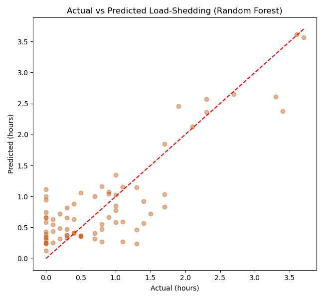
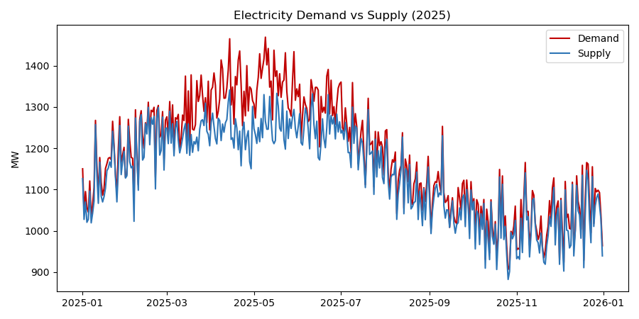
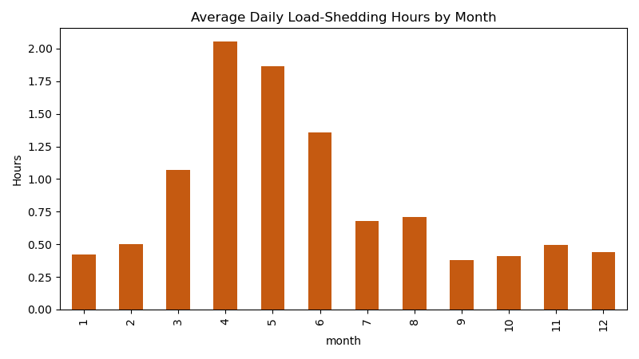
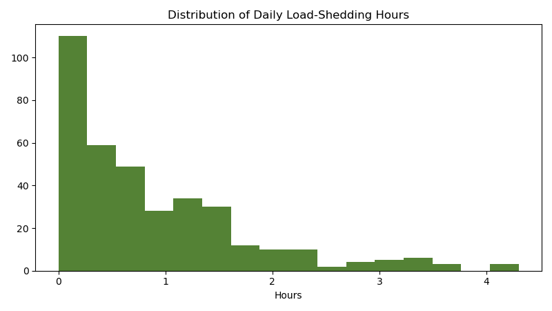
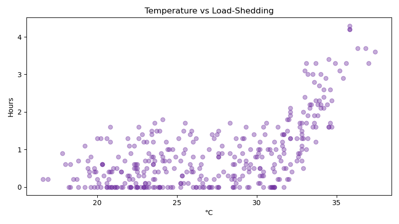

# 💡 Dhaka Electricity & Load-Shedding Analysis

Analyzing 365 days of electricity demand, supply and load-shedding in Dhaka.

A complete beginner-friendly Data Science project built with **Python, Pandas, NumPy, Matplotlib and scikit-learn**.
The dataset (365 days) is synthetic — generated with a fixed NumPy seed so anyone can reproduce it exactly.

## What's inside
- `src/generate_dataset.py` — creates the dataset in `data/`
- `src/analysis.py` — full analysis: summary tables, charts and insights
- `src/ml_model.py` — Machine Learning: trains and compares 2 prediction models
- `dhaka-electricity-loadshedding-analysis.ipynb` — Jupyter notebook version of the analysis
- `outputs/charts/` — 4 charts · `outputs/tables/` — 3 summary tables · `outputs/insights.md` — key findings
- `PROJECT_GUIDE.md` — a full beginner-friendly explanation of everything in this project

## How to run
```bash
pip install -r requirements.txt
python src/generate_dataset.py
python src/analysis.py
```

## Dataset columns
| Column | Meaning |
|---|---|
| date | Date |
| temperature_c | Average temperature (°C) |
| demand_mw | Electricity demand (MW) |
| supply_mw | Electricity supply (MW) |
| loadshedding_hours | Load-shedding hours that day |
| outage_count | Number of outages that day |

# Key Insights — Dhaka Electricity & Load-Shedding Analysis

- Dataset: 365 days of 2025.
- Worst month for load-shedding: **month 4** (average 2.1 hours per day).
- Total load-shedding in the year: **316 hours**.
- Correlation between temperature and load-shedding: **0.60** (hotter days, more shedding).
- Average daily demand: **1,184 MW** vs supply **1,141 MW**.


## Machine Learning — prediction model
Predict daily load-shedding hours from temperature, demand, supply and month.

| Model | R² / Accuracy | RMSE |
|---|---|---|
| Linear Regression | 0.790 | 0.42 hours |
| Random Forest | 0.725 | 0.48 hours |

**Best model: Linear Regression.** Linear Regression predicts daily load-shedding within about **0.42 hours (25 minutes)** on average (R² = 0.790).

Run it yourself: `python src/ml_model.py` (needs scikit-learn, already in `requirements.txt`).
Results are saved in `outputs/tables/model_results.csv`.



## Charts




